# Plan Concept A+ visual comparison

The original images below were supplied by the user on 26 November 2026; their values are illustrations. Delivered captures use realistic synthetic records at 393×780 in an intercepted local browser. They do not show the user's history or establish Samsung/WebView behavior.

| Subsection | Approved reference | Delivered dark browser capture | Delivered light browser capture |
| --- | --- | --- | --- |
| Overview | 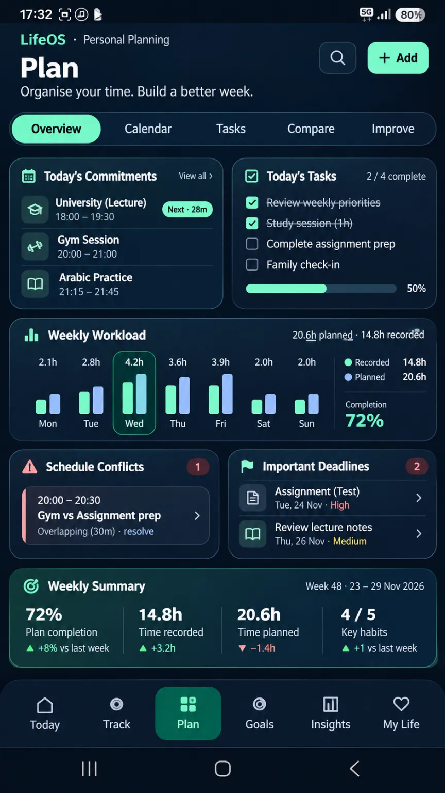 |  | 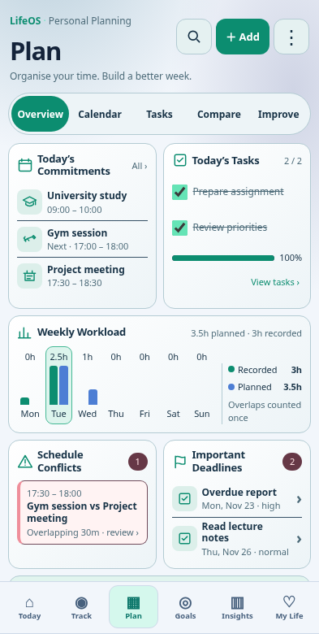 |
| Calendar |  | 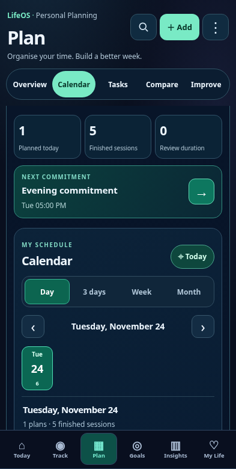 |  |
| Tasks | 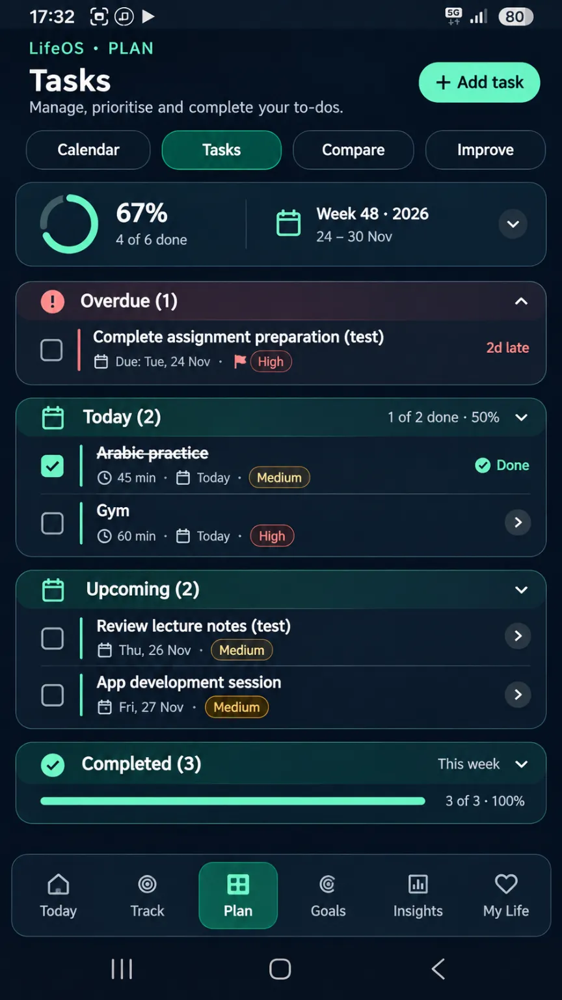 | 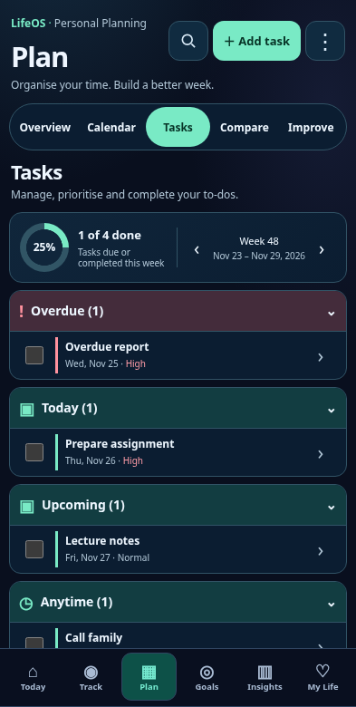 | 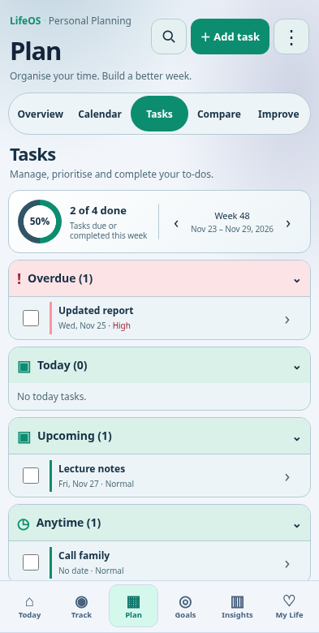 |
| Compare | 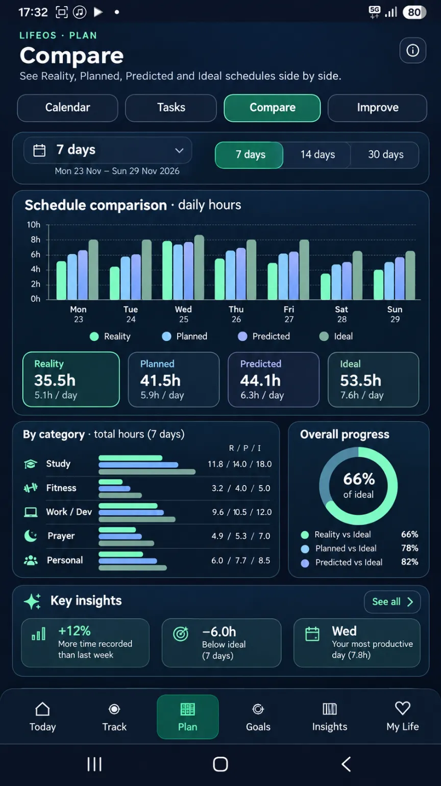 | 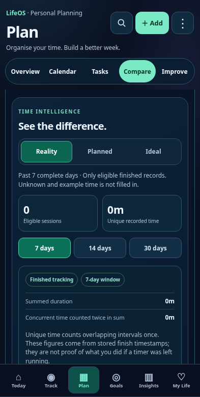 |  |
| Improve |  |  |  |

The shared Plan header, five tabs, navy cards and mint selection follow the existing Overview. The Calendar week view uses horizontally scrollable day columns at narrow widths so text and controls remain usable; it displays the full local day, so more vertical scrolling is needed than in the illustrative cropped reference. Very short blocks also appear in an expandable list. On a clock-change day, geometry uses the actual day length and an adjacent time scale appears if the shared scale differs. Repeated times are marked a/b, while activity details include the applicable UTC offset.

The day headings now remain visible during vertical map scrolling and track the timeline during horizontal swipes in browser tests. The captures below show the scrolled state with synthetic overlapping and short records. Native Android safe areas and scrolling are still unverified.

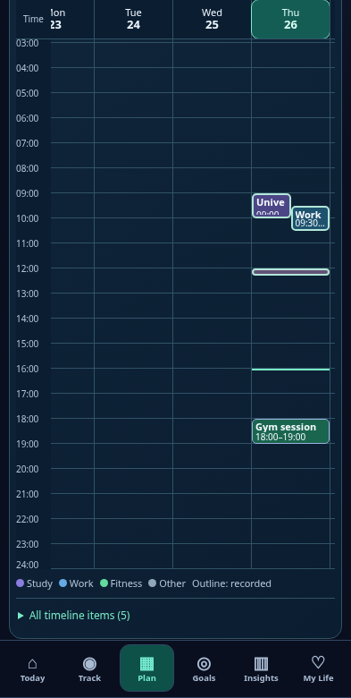
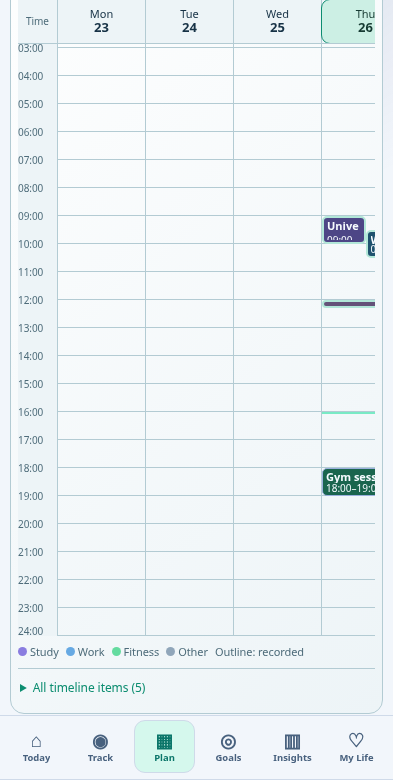

The following browser captures show the separate clock-change scale with synthetic records. It narrows the affected day’s blocks, which remain available in the item list; legibility on an Android device is still unverified.

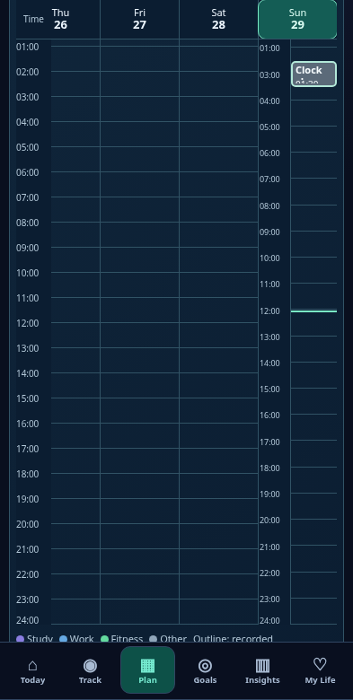
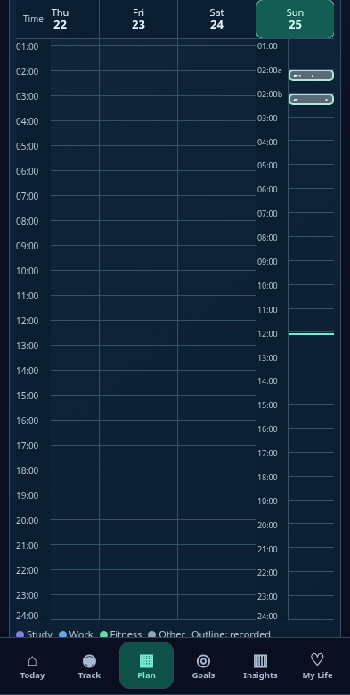
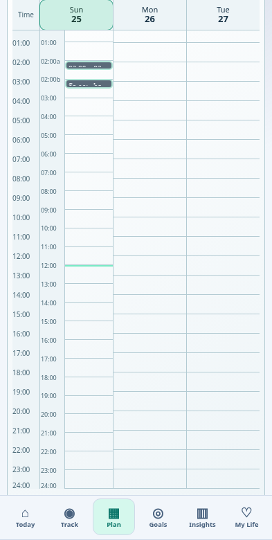
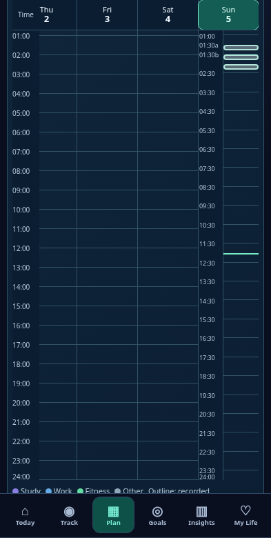

The planned-activity details sheet uses the selected theme and asks for explicit in-app confirmation before marking an activity skipped. This retains the original plan and does not create a tracked session. The following synthetic captures show the light sheet and the dark and light confirmation dialogs; device rendering is unverified.

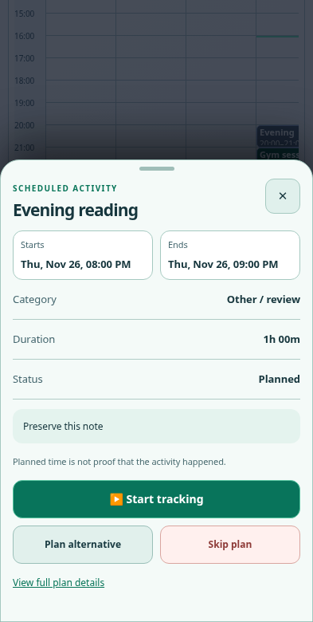
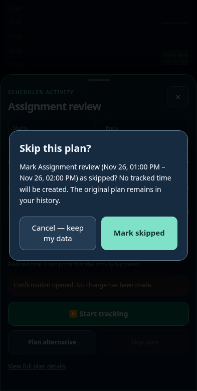
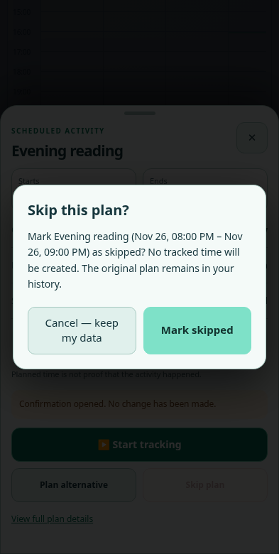

Repeating a planned activity shows the occurrence list and asks for in-app confirmation before saving; the approved dates and conflicts are rechecked. The reference does not depict this confirmation, and its native-device presentation remains unverified.

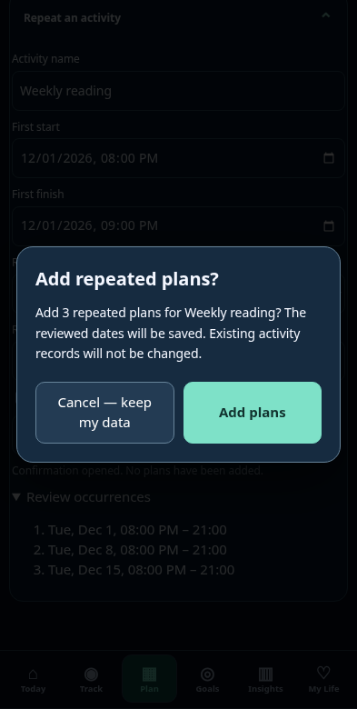
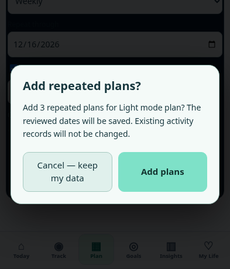

The browser can show a planned reminder and the Start now dock at once. This synthetic capture shows their positions; notification delivery and layout on an Android device are not established.

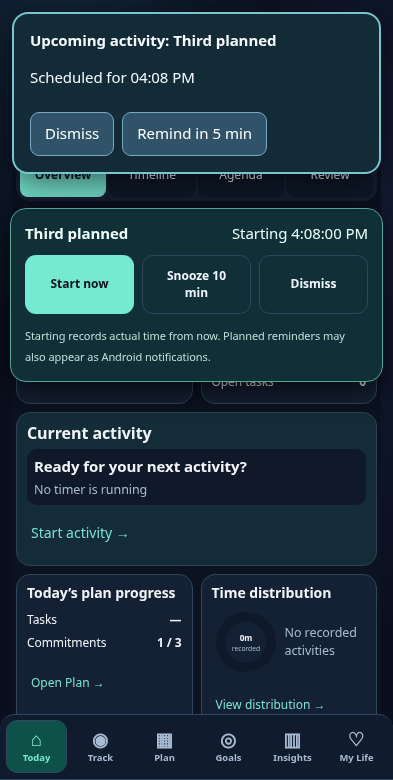

Tasks retains a separate Anytime group for records without valid dates. The percentage is calculated from non-example tasks due or completed in the selected week. Its integrated Create/Edit task sheet follows the reference's compact task fields and uses the existing workspace checkpoint; the original full controls remain under Advanced task tools. The sheet supports a date, optional deadline or scheduled time, priority, life area, optional estimate and notes. It checks for intervening edits and requires confirmation before deletion. Compare shows real recorded and planned time, evidence-based pattern projections and existing ideal routines, with an accessible daily-values table. It does not present the reference's illustrative statistics as real results; the ideal ratio is withheld for a period that has not ended. Category bars sum durations and may count overlaps. Improve shows only supported findings and links to the existing review and approval flows. No plan changes are applied automatically.

The V1 supporting board shows a full-page task editor and repeat control; the delivered editor is a scrollable sheet and does not implement recurring tasks. The original task list supplies completion controls; the sheet does not duplicate them. The preview below uses synthetic data and does not establish Android keyboard, safe-area or device behavior.

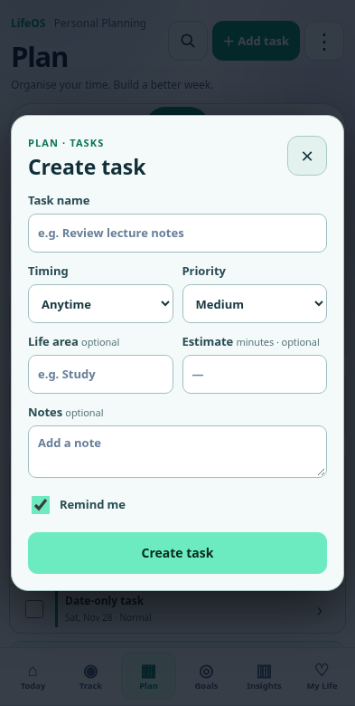

Compare now includes a labeled, data-scaled daily-hours axis and averages. The recorded average divides by the elapsed calendar days in the selected period, including today so far where applicable; the other available series use the selected days. An unconfigured ideal schedule and a future period’s recorded time are shown as unavailable, including in category rows. Evidence-based cards show a highest recorded day, a prior-period change only after the selected period ends with at least one minute recorded previously, and an ideal-time difference only where an ideal is configured. They describe recorded time, not productivity or proof that plans were completed. The three ratios use unique durations, are withheld until a period has ended, and are labeled as comparisons rather than completion. Ideal routines are the current configuration applied to the selected period; historical target changes are unavailable.

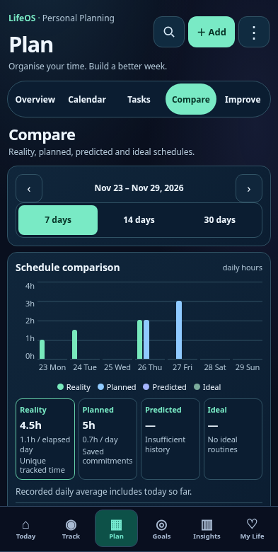
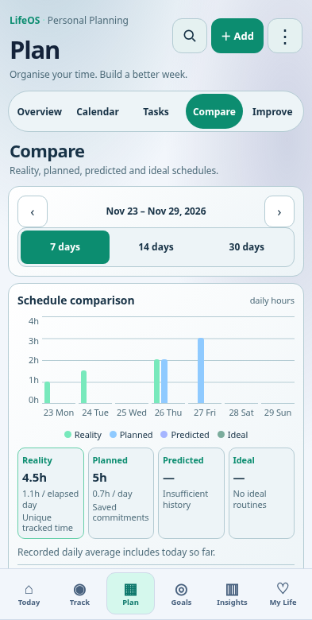

Full-page captures are also available in `current/v1-compare-dark-full.png` and `current/v1-compare-light-full.png`. A stitched full-page browser capture places the fixed bottom navigation partway down the image; it is not a screenshot of the navigation's position after scrolling.

Improve's duration cards now show the actual active duration and the median and sample count for eligible earlier same-named sessions. They do not infer a missed commitment or automatically change a record. The visible Review action opens the original activity, with a separate full list for larger volumes. For a confirmed shortfall, a commitment selector and four recovery choices open the existing reviewed-commitment sheet; preview and in-app consent remain mandatory. This is a longer flow than the reference's single-screen layout, and the illustrative percentage recommendations are not fabricated.

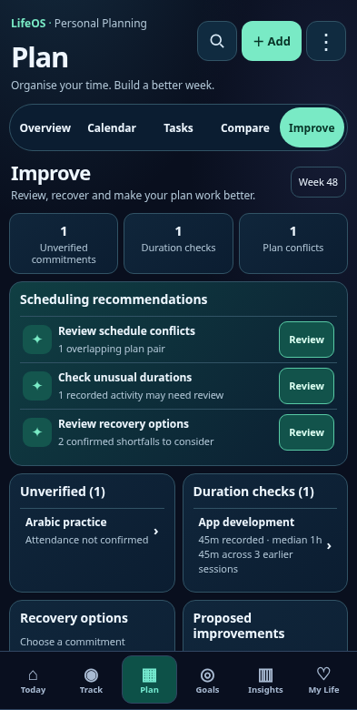
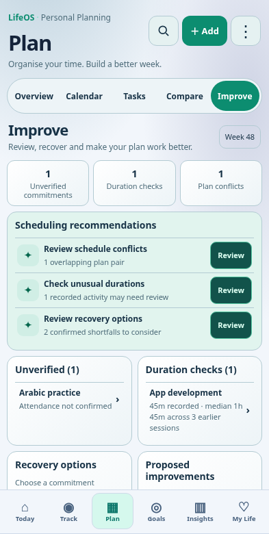
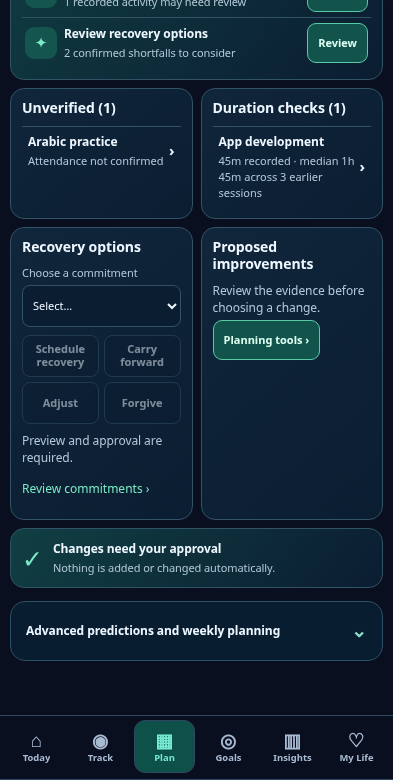
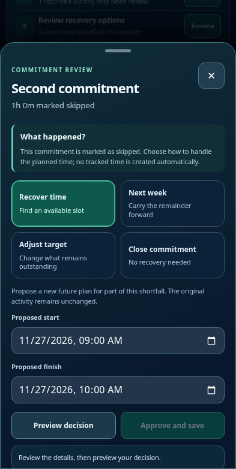
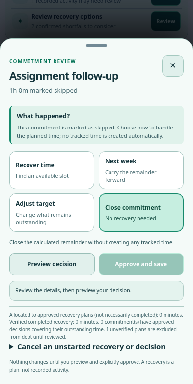
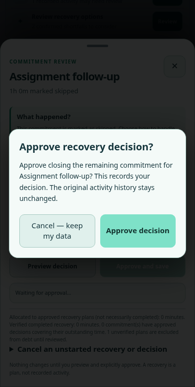

The screenshots intentionally differ in content and numbers, may require scrolling, and omit unsupported ratios and suggestions. Calendar bulk editing of an entire recurring series is not implemented; each generated occurrence remains an ordinary plan. Device rendering, native system insets, keyboard behavior and final visual acceptance remain unverified.
