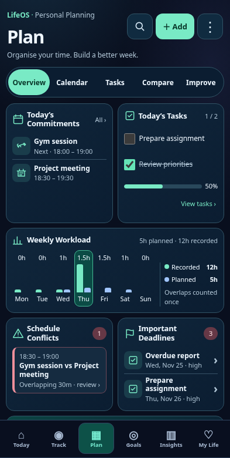
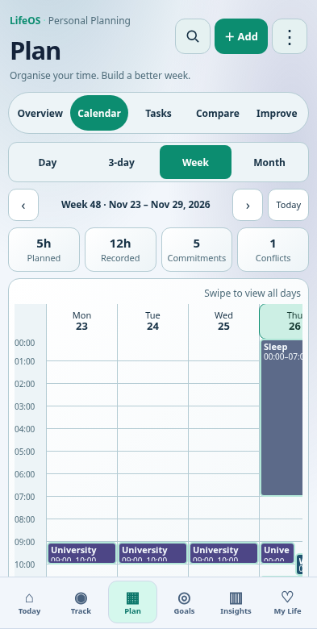
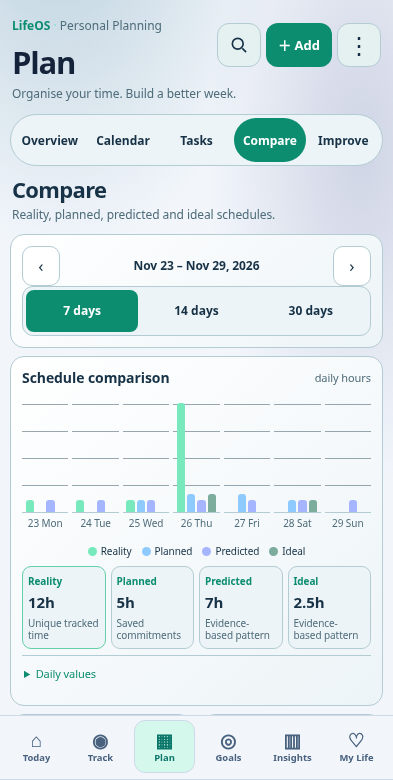
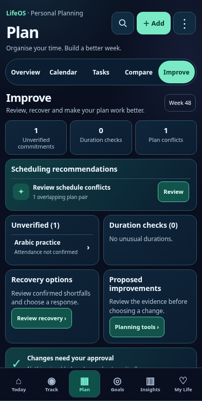
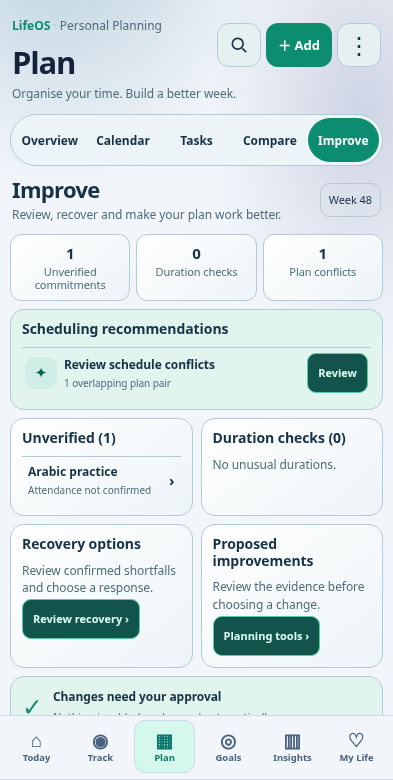

# Plan Concept A+ visual comparison

The original images below were supplied by the user on 26 November 2026; their values are illustrations. Delivered captures use realistic synthetic records at 393×780 in an intercepted local browser. They do not show the user's history or establish Samsung/WebView behavior.

| Subsection | Approved reference | Delivered dark browser capture | Delivered light browser capture |
| --- | --- | --- | --- |
| Overview |  |  |  |
| Calendar |  |  |  |
| Tasks |  |  |  |
| Compare |  |  |  |
| Improve |  |  |  |

The shared Plan header, five tabs, navy cards and mint selection follow the existing Overview. The Calendar week view uses horizontally scrollable day columns at narrow widths so text and controls remain usable; it displays the full local day, so more vertical scrolling is needed than in the illustrative cropped reference. Very short blocks also appear in an expandable list. On a week containing a daylight-saving transition, each day's geometry uses its actual length; the shared axis follows the first day and an explanatory note directs the user to exact item times.

Tasks retains a separate Anytime group for records without valid dates. The percentage is calculated from non-example tasks due or completed in the selected week. Its editor uses the original task form and controls. Compare shows real recorded and planned time, evidence-based pattern projections and existing ideal routines, with an accessible daily-values table. It does not present the reference's illustrative statistics as real results; the ideal ratio is withheld for a period that has not ended. Category bars sum durations and may count overlaps. Improve shows only supported findings and links to the existing review and approval flows. No plan changes are applied automatically.

The screenshots intentionally differ in content and numbers, may require scrolling, and omit unsupported ratios and suggestions. Calendar bulk editing of an entire recurring series is not implemented; each generated occurrence remains an ordinary plan. Device rendering, native system insets, keyboard behavior and final visual acceptance remain unverified.
