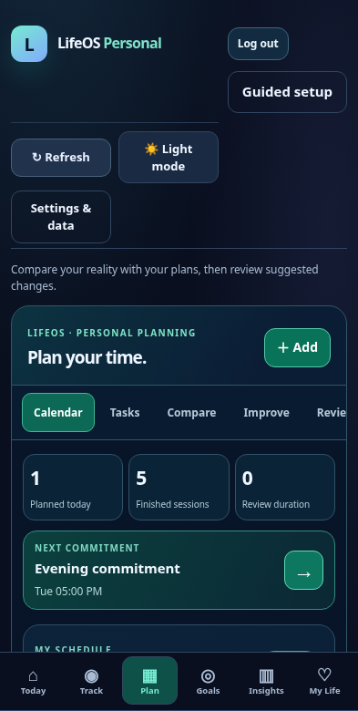
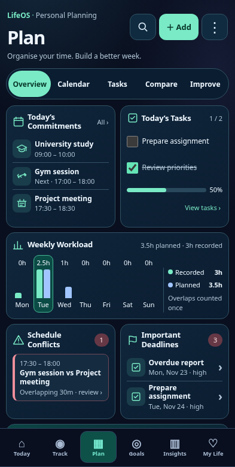
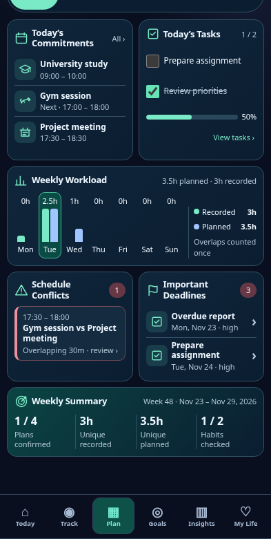

# Plan Overview visual comparison

The user supplied the desired Overview reference in chat. Its original image file was not available in this workspace, so a pixel diff cannot be generated or stored. These captures use local, synthetic records at 393×780; they are not Android-device photographs or proof of user approval.

| Before this work | Delivered dark | Delivered light | Bottom clearance |
| --- | --- | --- | --- |
|  |  |  |  |

Compared with the supplied reference, the implementation uses the same five main tabs, paired commitments/tasks cards, seven-day workload chart, paired conflict/deadline cards and weekly summary. The secondary settings control preserves access to review, diagnostics, theme and account settings. Text and targets are sized for a mobile browser, so the complete populated page may require a short scroll instead of squeezing all controls into one viewport.

Recorded and planned bars show unique occupied time; overlapping intervals count once. “Plans confirmed” counts only explicitly completed plans or links to a finished session. Habit counts mean definitions with a recorded check, not assumed completion. The reference's illustrative completion rate and week-over-week changes are not shown without corresponding evidence. Colors, type rendering and proportions still need the user's device review; native Android insets and keyboard behavior remain unverified.

On 26 November 2026, `tests/plan-overview-model.cjs` and `tests/plan-overview.cjs` passed locally with synthetic data, including dark and light themes and 360×650, 393×460 and 412×780 browser viewports. The existing Today mobile visual workflow script passed all 39 local checks. These checks establish behavior and browser geometry; they do not establish pixel fidelity to the unavailable source image or Samsung system-inset behavior.
