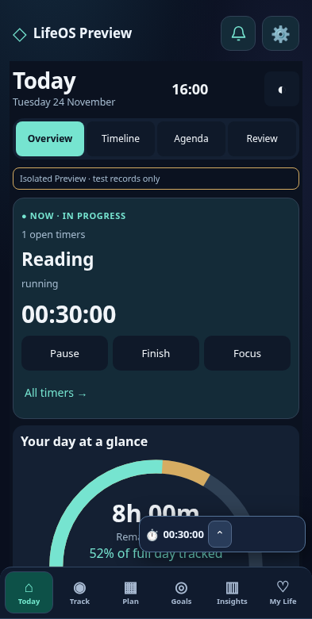
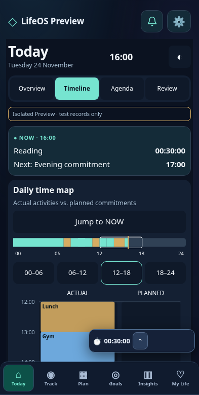
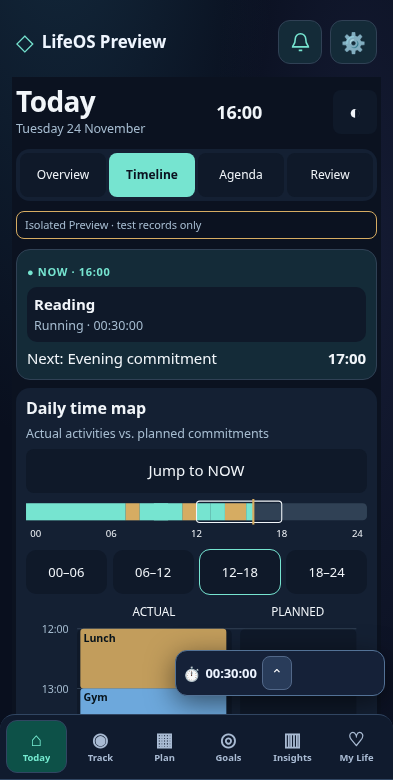
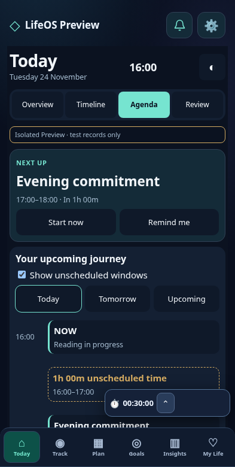
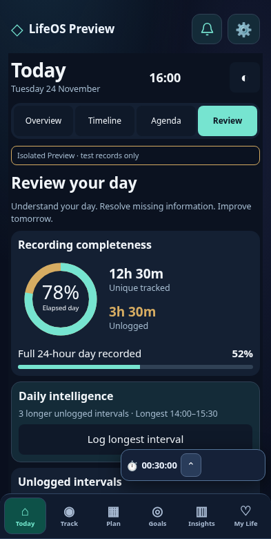
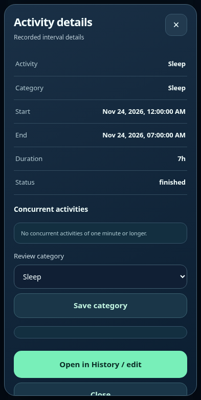
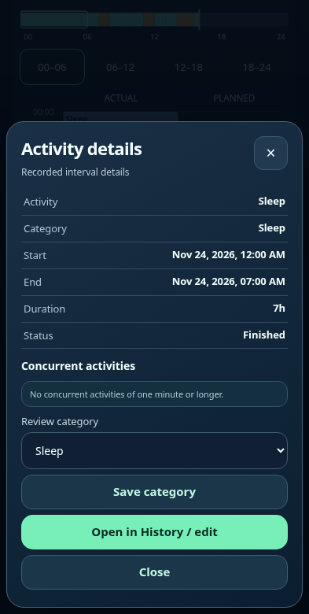
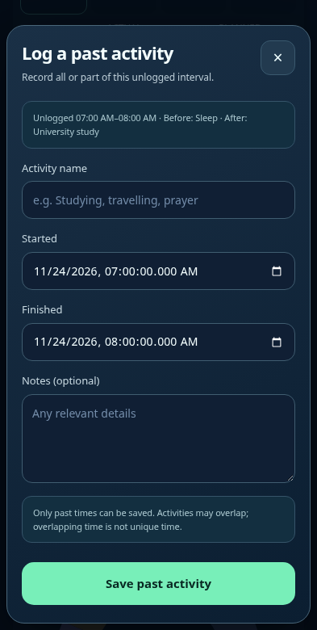
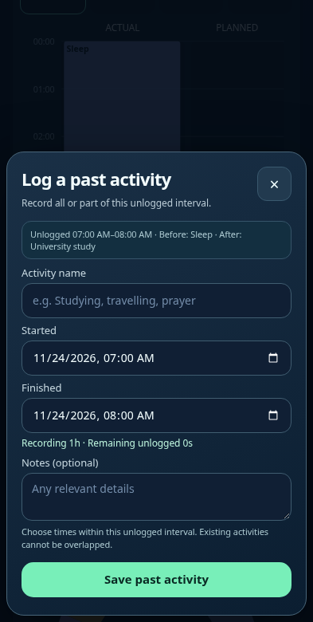

# Today visual comparison and annotations

All screenshots below use an isolated synthetic fixture at 393×780. The left column is the implementation at `5aa749b6173f4aa65c281672f0f785ef52cd2f02`; the right column is the current workspace capture. These are implementation-to-implementation comparisons, **not** comparisons against the missing approved source mockup.

| Subsection | Before | Current | Review note |
| --- | --- | --- | --- |
| Overview |  |  | Preserve the Concept A+ hierarchy. |
| Timeline |  |  | Categories remain distinct; map windows now use local clock boundaries. |
| Agenda |  |  | Use unscheduled-time language. |
| Review |  |  | Keep unknown time separate from distraction. |
| Activity details |  |  | Compact rows, readable precision and status; no blank status box. |
| Gap entry |  |  | Practical time controls, remaining-time summary and accurate gap restriction. |

The Android screenshots supplied in chat are device observations; their original files are not included in this repository. Bottom navigation remains a native-device issue until measured and verified. The approved Today mockup images are still required for a true desired-versus-delivered comparison.
