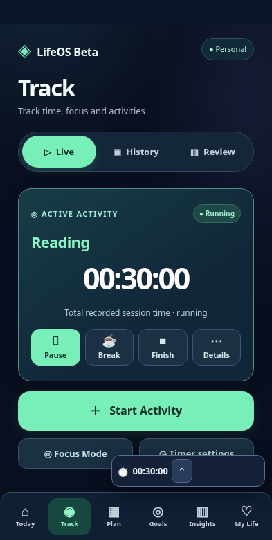
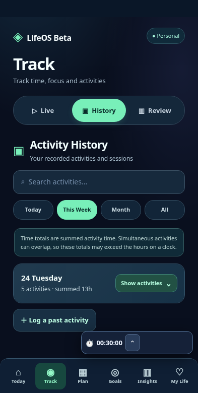
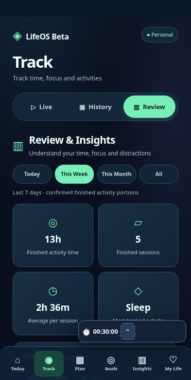

# Track Concept A

Compare the synthetic implementation captures from the prior V250 baseline and current workspace:

| Subsection | Before | Current |
| --- | --- | --- |
| Live |  |  |
| History |  |  |
| Review |  |  |

The approved original Live, History and Review mockup images are missing; these captures do not replace them. Preserve Concept A and verify its existing actions before changing its presentation. Browser captures do not establish native notifications or Focus Mode behavior.
